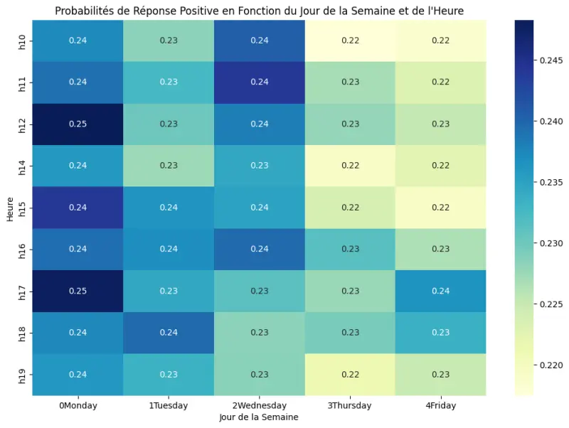
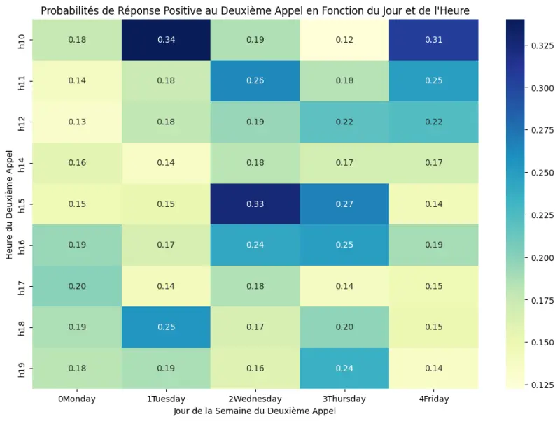
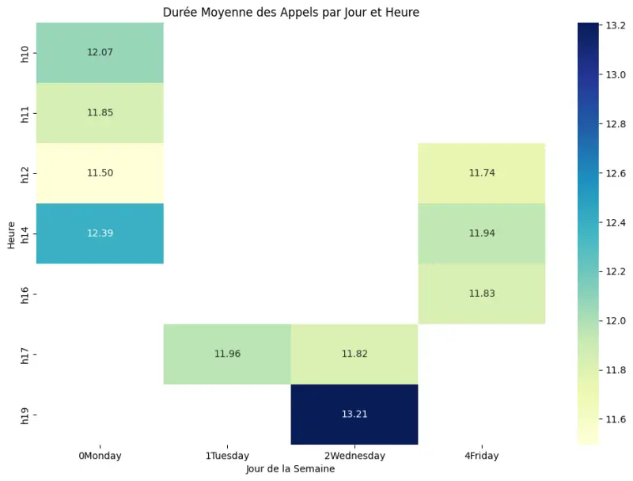

# Call-Center Stochastic Modelling

[](https://github.com/LaCobble/Modelisation-Stochastique-Call-Center/actions/workflows/ci.yml)
[](LICENSE)


Analysis of a call center's outbound calls with **Bayesian networks** (pyAgrum) and pandas: when should a lead be called, and does changing the caller help, to maximise the chance that the lead answers?



*Probability of a positive answer to the first call by weekday and hour, as estimated by the Bayesian network in `FirstCall.ipynb` (chart taken from the notebook's saved output; labels in French).*

## What it does

The dataset (not published, see below) describes up to four call attempts per lead (`calls_a1` … `calls_a4`): date, weekday, hour, duration, caller ID, whether the lead answered and whether the caller changed. The notebooks study three questions:

1. **Day and hour**: which weekday / hour combinations give the best answer rate, for the first and the second call.
2. **Change of caller**: does calling back from a different caller change the probability that the lead answers?
3. **Call length**: which weekday / hour slots give the longest calls.

## Notebooks

| Notebook | Content |
| --- | --- |
| [`src/Initiation.ipynb`](src/Initiation.ipynb) | Data loading and exploration, first Bayesian network `hour_a1, hour_a2 -> lead_answered_a2`, parameter learning, prediction and confusion matrix. |
| [`src/FirstCall.ipynb`](src/FirstCall.ipynb) | Network `weekday_a1, hour_a1 -> lead_answered_a1`; ranks every weekday / hour pair by answer probability (heatmap above). |
| [`src/FirstCaller_Version_B.ipynb`](src/FirstCaller_Version_B.ipynb) | Variant adding the caller ID, with a train / test split (scikit-learn) and a smoothing prior. |
| [`src/SecondCall.ipynb`](src/SecondCall.ipynb) | Best combinations of first-call and second-call slots for reaching the lead on the second attempt. |
| [`src/Change_Caller.ipynb`](src/Change_Caller.ipynb) | Answer rate depending on whether the caller changed between attempts. |
| [`src/Call_Length.ipynb`](src/Call_Length.ipynb) | Average call duration by weekday and hour. |

## Charts

Taken from the outputs of the original notebook runs (labels in French):

<p align="center">


</p>

*Left: probability of an answer to the second call by weekday and hour (`SecondCall.ipynb`). Right: average call duration for the ten weekday / hour slots with the longest calls (`Call_Length.ipynb`).*

## Findings

From the outputs of the original runs:

- Answer rates on the first call vary little with the time slot (about 22 % to 25 %); Monday at noon and at 17 h come out on top.
- The second call depends much more on the slot (about 12 % to 34 %), with Tuesday 10 h and Wednesday 15 h on top.
- A model based on time slots alone mostly predicts "no answer": its accuracy (about 74 % on the first call, 79 % on the second) is close to the share of unanswered calls, so time slots are a weak predictor on their own.
- The written conclusions of the project suggested calling back from a different caller and favouring longer calls; `Change_Caller.ipynb` has no successful run saved, so treat that point as a hypothesis.

## Requirements

- Python 3.11 and Jupyter.
- The packages in [`requirements.txt`](requirements.txt): pandas, numpy, matplotlib, seaborn, pyAgrum, scikit-learn, tabulate.
- **The data is not included**: the call datasets are confidential. The outputs of `Initiation`, `FirstCaller_Version_B` and `Change_Caller` were cleared (they contained rows of the dataset or local paths); the other notebooks keep their charts. No notebook can be re-executed without the data files placed in `src/` at the paths the notebooks expect (`calls_a1.csv/calls_a1.csv` … or `calls_a1.csv.bz2` …).

## Run

```bash
git clone https://github.com/LaCobble/Modelisation-Stochastique-Call-Center.git
cd Modelisation-Stochastique-Call-Center
python -m venv .venv && source .venv/bin/activate
pip install -r requirements.txt jupyter
jupyter notebook src/
```

## What it demonstrates

- Building **Bayesian networks** by hand with pyAgrum (variables, arcs), learning their conditional probability tables from data (`BNLearner`), and running inference (`LazyPropagation`).
- Evaluating a probabilistic classifier with accuracy and a confusion matrix, and reading the result critically against the class balance.
- Data preparation and visualisation with pandas, matplotlib and seaborn on a multi-million-row dataset.

## Context

School project, 4th-year course on stochastic modelling (2024), done in a team of two. The notebooks are written in French.

## Contributing

This is an archived learning project, but issues and pull requests are welcome: see [CONTRIBUTING.md](CONTRIBUTING.md) and the [Code of Conduct](CODE_OF_CONDUCT.md).

## License

[MIT](LICENSE) © La_Cobble
